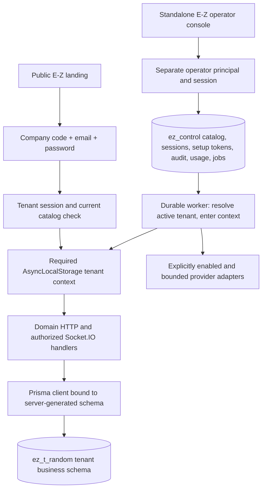

# ADR-001: tenant-local data and a standalone E-Z operator console

Status: selected architecture, implemented as a **production-branch candidate**, requiring final review and external release checks. Updated2026-10-28. This ADR supersedes the earlier shared-row/global-identity model and the proposal to extend an external ERP operator console. Historical proposals and the Arena record remain evidence, not instructions for this release.

## Decision and boundaries

Retain React/Vite, TypeScript, Express, Prisma, Socket.IO and PostgreSQL as a modular monolith. Use one Railway PostgreSQL database, **one server-generated schema per tenant**, and a separate `ez_control` control plane. Build a new E-Z operator console inside this application. The ERP repository is a read-only interaction/reference source; there is no runtime SSO, provisioning bridge, shared password database, shared company directory or dependency on an external console.

A tenant is a company/workspace. A code such as`A0000Z` selects a tenant; it is public, immutable and not a password. Login requires company code+email+password and an active account inside that selected tenant. The same email can have separate accounts/passwords in several companies. Customer roles are tenant-local ADMIN/MEMBER; the catalog records the designated owner's user ID. Do not introduce a global identity/membership layer implicitly or infer membership from an email domain.

This is application-enforced schema selection, not a claim of one database/role per customer or installed PostgreSQL RLS. The application database credentials can administer several schemas; raw SQL, provisioning, migrations and context resolution are privileged code paths. Server-generated identifier validation, no client schema selector, no default/public fallback, tenant-local constraints and negative tests are required. SQL-injection prevention and database least privilege remain independent obligations.

## Implemented source contract

| Boundary | Current source behavior |
|---|---|
| Control plane | `platform/store.ts` owns catalog/provisioning, setup/activation, operators, suspension, limits and safe audit records. `ez_control` is not exposed through tenant Prisma. |
| Tenant identity | Catalog DTO includes `id`, immutable`code`, `name`, internal`schemaName`, `status`, owner fields, `seatLimit`, storage bytes used/limit and AI tokens used/limit. Public DTO omits`schemaName`. Status is PROVISIONING/ACTIVE/SUSPENDED/FAILED. |
| Tenant schemas | Internally generated`ez_t_` identifiers use16–64lowercase hexadecimal characters. Provisioning executes the reviewed, unqualified tenant DDL inside the selected schema transaction. There are18current Prisma business models, including Project. Existing public data is not an implicit tenant. |
| Context | `tenancy/context.ts` provides validated AsyncLocalStorage context. `database/client.ts` resolves every tenant Prisma operation through it and throws when context is absent. HTTP, sockets and worker handlers must enter context independently. |
| Login/session | Company code normalizes to uppercase and email to lowercase. Password hashing uses bcrypt cost12; new passwords are12–128characters and at most72UTF-8bytes. Login saves a regenerated session bound to tenant ID and user session version. Current catalog/account status is rechecked. |
| Session separation | Customer cookie`connect.sid` and operator cookie`ez.operator.sid` have separate secrets/principals; operator cookie path is`/api/console`. A customer ADMIN is not an operator. JSON mutations require trusted-origin checks and throttles. |
| Provisioning/setup | Operator supplies company and initial owner details. Owner starts without a password. The24-hour one-use setup token is stored hashed, shown once and delivered privately by the operator; there is no fake automatic email. `/activate` sets the password and requires a later explicit login. |
| Invitations/recovery | Tenant admin invitations reserve account slots; activation uses tenant-scoped one-use credentials. Operator owner recovery requires a recent operator sign-in, issues a one-hour setup link and invalidates affected access when redeemed. Exact policies/tests are in source; no self-service email recovery or operator MFA is claimed. |
| Projects | Projects are visible within the company; creator/admin edit policy and optimistic409conflicts are enforced. Project backlog tasks can have no sprint. Project visibility does not remove private conversation/personal-note boundaries or grant every member every task permission. |
| Realtime/files | Socket authority is tenant/session/user-bound and rechecked; rooms/recipients are scoped. Files use server-owned tenant paths, authorized download checks and atomic quota reservation. No public file directory substitutes for authorization. |
| Worker | API cron loops are off. Separate worker claims durable, idempotent jobs with leases/fencing, enters the current active tenant, and persists reminders. Readiness heartbeat covers scanning and owned job renewal. |
| Optional providers | Core does not require Google/OpenAI/SMTP keys. This release's Google, Drive and Sheets routes are disabled. AI and SMTP require explicit flags/configuration; AI also requires tenant budget. No live provider, payment flow or external backup activation is implied. |

## Cost and capacity contract

The selected development/limited-pilot incremental-spending ceiling remains **$0**. Advertised free allowances do not establish always-on compute, reliable worker execution, unlimited inference or backup durability. No purchase or automatic paid overage is authorized by this ADR.

- Storage defaults to100MiB per company and AI allowance to0tokens. Storage reservations precede writes. AI reserves conservatively before a provider call, settles actual usage once and keeps uncertain outcomes charged. The token allowance is cumulative, not an implemented monthly billing cycle or currency guarantee.
- Account capacity defaults to10slots, configurable1–10,000. Active and pending reserved accounts count for admission. This is **not** measured active-member subscription billing; checkout, paid plans and authoritative provider entitlements are still absent.
- Each process caches at most32tenant Prisma clients by default (`TENANT_DB_MAX_CLIENTS`, allowed1–128), with no eviction. The next distinct tenant fails with503until capacity is deliberately changed or the process restarts. This is a resident-client limit, not proof that the system can host32paying customers at an SLA.
- Each client permits2connections by default (`TENANT_DB_POOL_SIZE`, allowed1–10). The control pool permits5; the API tenant-session pool permits10. One fully used API process can therefore allow up to79connections and a worker up to69before maintenance tools and extra replicas. Actual opening is lazy, but the real database connection/CPU/RAM allowance must be measured before admission. Increasing these values silently is not the scaling plan.
- Catalog listing/scanning currently limits500records. Keep the pilot within a measured smaller admission cap; do not create more companies than all API/worker caches and database resources can support. There is no implemented eviction/paginated unlimited-worker scan promise.
- Single API replica is the initial topology. Multi-instance realtime/limits, lower-connection routing and tenant-schema migration orchestration require separate validation before expansion.

## Data evolution, recovery and release

The owner permits reset of identified existing E-Z test data. That does not authorize deletion of another database or future customer data. This candidate does not silently backfill public rows into customer schemas. Existing Prisma migration SQL remains a historical/legacy path; new tenant provisioning uses the reviewed tenant DDL. Before evolving established tenant schemas, inventory versions, back up, test a representative upgrade and provide an explicit controlled per-schema rollout. API startup must not replay old public-qualified migrations across tenants.

Encrypted backup tooling covers the database catalog and schemas plus an explicitly included upload root. Local synthetic restore drills passed. Private bucket configuration, schedule, retention and production restore evidence remain external work. Daily/seven-copy backups,30-day deletion recovery and a one-business-day restore are separate owner targets; seven snapshots do not implement30days of deleted-item recovery. No current universal soft-delete recovery or contractual SLA is claimed.

Once multiple tenants have data, rollback to the old unscoped binary is unsafe. Prefer a compatible reviewed artifact, stop affected writes, or roll forward. Restoring a snapshot requires reconciliation of later writes and external effects; SQL rollback cannot unsend mail or undo charges. Keep current deployment identity, domain/PWA behavior and exact-commit release authorization explicit.

Read the [production runbook](../operations/production-runbook.md), [ordered rollout checklist](ROLLOUT-CHECKLIST.md) and [remaining decisions](DECISIONS.md). Builds and synthetic tests are evidence for their cases; they are not production readiness or compliance certification.
