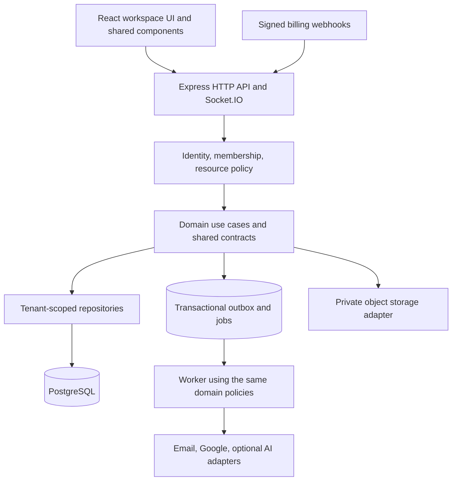

# Target architecture and invariants

Proposed baseline, supported by the focused [Arena decision](arena/DECISION.md) and pending owner choices recorded in DECISIONS.md. The aim is a coherent SaaS, with a migration that preserves existing data. Keep the working React/Vite, Express/TypeScript, Prisma/PostgreSQL and Socket.IO foundations unless a measured constraint justifies a change. Avoid changing framework, database, identity and tenant semantics in the same release.

## System boundaries

One repository and a modular monolith are the initial default. API and worker are separate process entry points from the same codebase. A single API replica is acceptable initially if it meets measured needs; adding replicas requires shared Socket.IO delivery/quotas and job concurrency tests. Choose services after confirming hosting supports long-lived sockets and worker scheduling. An always-on worker cannot be assumed on a sleeping free web tier.

Suggested module boundaries: identity, workspaces/membership, projects, tasks/sprints, collaboration, files, integrations, notifications/jobs, billing/entitlements, audit, and optional AI. Modules expose use cases and contracts; they do not reach into one another's tables from arbitrary controllers. Shared infrastructure owns configuration, database/transaction context, error transport, logging, clock, job and vendor adapters.

## Data model

| Entity | Responsibility and required boundary |
|---|---|
| User / AuthAccount | Global person and verified provider identity; no global customer-business ADMIN role. |
| Workspace | Tenant/security/billing boundary, slug, locale/timezone, lifecycle. |
| Membership | Unique workspace+user, role, status, invitation/join/revocation lifecycle. Owner transfer and last-owner safeguards. |
| Project / ProjectMember | Workspace-owned project; project privacy/access if required. Never infer access from knowing a UUID. |
| Sprint / Task | Workspace+project ownership; task sprint optional for backlog; authorized hierarchy, version, database invariants. |
| Conversation / Message / Attachment | Explicit workspace and conversation access; links to tasks never grant access by themselves. |
| Note / Update / Summary / Setting | Workspace-scoped even when personal; uniqueness includes workspace; optional AI status separate from work performance. |
| IntegrationConnection | Provider subject, workspace/user grant, scopes, encrypted tokens, expiry/revocation; credential references never exposed in API DTOs. |
| Subscription / Entitlement / UsageLedger | Workspace billing customer, provider state, plan version, authoritative access and atomic usage/reservations. |
| Job / Outbox / WebhookReceipt | Tenant context, unique idempotency keys, state, lease, retry, error metadata; event receipt deduplication and reconciliation. |
| AuditEvent | Actor, workspace, action, target, safe before/after metadata, timestamp, request/job ID; restricted append-only access. |

Use workspace_id consistently in persisted tenant-owned data; API/frontend may call this workspaceId. Do not introduce competing Tenant and Organization tables for the same concept. Parent (workspace_id,id) compound uniqueness and child compound foreign keys make a cross-workspace parent relation structurally invalid. Define exceptions explicitly (global identity, global product catalog, webhook receipt before tenant resolution).

Assignee/member relations must belong to the same workspace, not merely point at an existing global User. Validate active membership for new assignments and project access; preserve historical attribution when a membership is revoked rather than breaking audit/history references.

Personal account preferences can be global; personal work content must have an explicit owning workspace or a deliberately separate personal workspace. Workspace deletion cannot cascade-delete a global identity shared by other memberships.

## Isolation and authentication

1. Verify the session/provider identity, resolve the requested workspace, verify active membership, then load the resource within that scope and apply its permission policy. Validate exactly the same ID that the handler uses. Workspace ID in a URL/header/body is a selector, never proof of access.
2. Every repository accepts a required TenantContext. Ban unscoped feature access to the raw Prisma client through lint/import boundaries and repository review. Context is explicit across HTTP, worker and Socket.IO; no ambient default tenant or unsafe process-global variable.
3. Add PostgreSQL RLS as defense in depth when selected and tested: app role is not table owner and has no BYPASSRLS; migrations use a separate role. Set context transaction-locally on the same connection as queries. Missing context denies access. Test pooled reuse, concurrency, aborts, and out-of-transaction queries; a Prisma extension alone is insufficient proof.
4. Tenant isolation and resource permissions are separate checks. Preserve private task/conversation semantics until the product decides otherwise. A tenant-scoped room can still leak private projects; authorize narrower rooms or individual recipients and minimize payloads.
5. Revalidate membership/role changes and disconnect or invalidate affected sessions/sockets. Clients remove only their own event handlers; one view cannot shut down the shared socket connection.
6. Use managed identity rather than building password/recovery cryptography from scratch. Provider choice is an owner decision. Google credentials belong to the platform for ordinary sign-in; Drive/Sheets scopes require separate explicit connection and can be absent.

## Consistency contracts

The currently empty shared workspace becomes the source of runtime request/response/event schemas and inferred TypeScript types, or one OpenAPI contract generates them. Pick one authority. A field rename such as progressMin versus minProgress must fail contract tests. Standardize error codes/messages, correlation IDs, pagination, dates, resource version conflicts, file states and job outcomes. Internal exception details and credential-bearing records never become DTOs accidentally.

Suggested frontend structure: app shell/routes/providers; shared UI primitives/tokens; feature modules with hooks/views; one API client/error mapping; one workspace-aware query-key factory; one owned socket lifecycle. Workspace changes cancel requests and discard stale results; persisted browser state uses explicit workspace namespaces. Public routes, invitation acceptance, task deep links and settings use durable URLs and browser history.

## Side effects, billing and failure behavior

Commit business changes and an outbox event transactionally; process external effects asynchronously with idempotency and retry. Exactly-once email delivery is not generally guaranteed by a local transaction: use provider idempotency where supported, stable message IDs/receipt state and reconciliation. Cron is a producer of uniquely keyed jobs; every app replica cannot independently perform the effect.

Billing access derives from verified server-side provider state and internal entitlements, never redirect parameters or UI flags. Webhook handlers verify provider signatures, store unique receipts, tolerate retries/reordering and reconcile current objects. Meter seats/storage/AI atomically by workspace. Product plans and tax/refund rules remain explicit owner choices.

Resolve billing customers/subscriptions through a server-owned customer-to-workspace mapping; a signed event does not make arbitrary client-originated workspace metadata authoritative. Test that a valid event for customer A cannot mutate workspace B.

Required core dependencies fail readiness clearly. Optional integrations fail only their capability and offer an honest status. No fabricated email success or LOW-impact AI fallback on upstream outage. AI is opt-in with tenant budgets, source disclosure, bounded concurrency and validated outputs; no guarantee of a perpetual free inference tier.

## Migration and release invariants

- Inventory and back up before production writes. Rehearse a restore and a migration using a representative data copy with controlled access.
- Expand, backfill, reconcile, validate constraints, enforce scoped reads/writes, then contract. Backfill must be restartable and must preserve identity/ownership.
- Maintain a compatibility window only for the legacy workspace. Do not introduce a default tenant fallback for customer traffic.
- Once multiple tenants exist, rolling back to the old unscoped binary is unsafe. Disable the capability or roll forward; a full restore is an explicit recovery operation with known data-loss implications.
- Test failure at migration/job/webhook boundaries. Verify local/staging/production separation from actual settings; repository code alone cannot establish it.

Hosting recommendations and current vendor limits belong in RESEARCH.md. The implementation sequence and release gates belong in IMPLEMENTATION-PLAN.md; final invariants apply to every agent's work.

## Proposed initial providers, subject to owner requirements

The independently judged proposal selects Railway for the long-running same-origin frontend/API and worker, Supabase for PostgreSQL/managed Auth/private Storage, Resend for platform mail, and Sentry for scrubbed errors. Paddle is a conditional merchant-of-record candidate; compare Stripe after seller eligibility/tax responsibilities are known. Do not deploy both primary databases or redundant identity stacks. Use an explicit verified-identity exchange into one backend-owned session authority; the provider and application cannot have divergent revocation/account-linking rules.

Use free/local tiers for development and a deliberately limited pilot. The champion illustrates Railway Pro + Supabase Pro minimums totaling $45/month before usage/extras; this is a recommendation for those tiers, **not a required budget, complete bill, or evidence that all SaaS must pay that amount**. D6 decides the actual ceiling. Evaluate suitable lower tiers and self-managed backup controls against measurable recovery/runtime requirements rather than buying plans solely for their names. No account, subscription or provider migration was activated by this audit.
